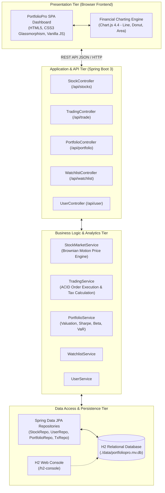
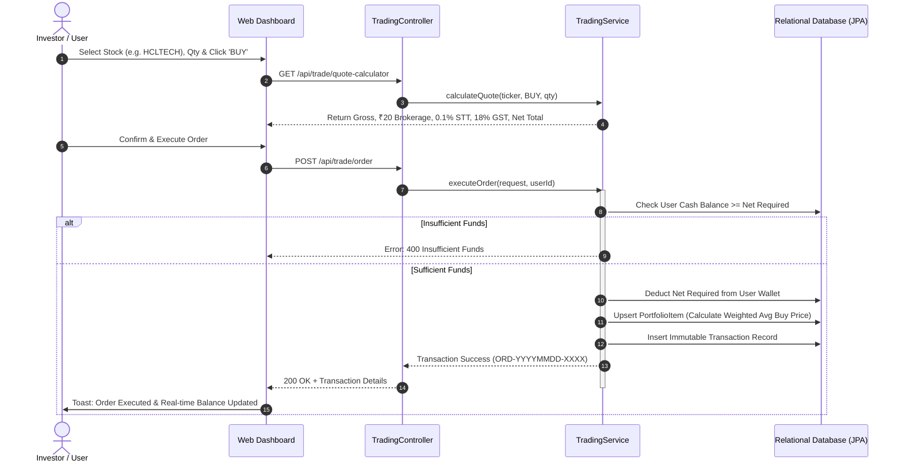
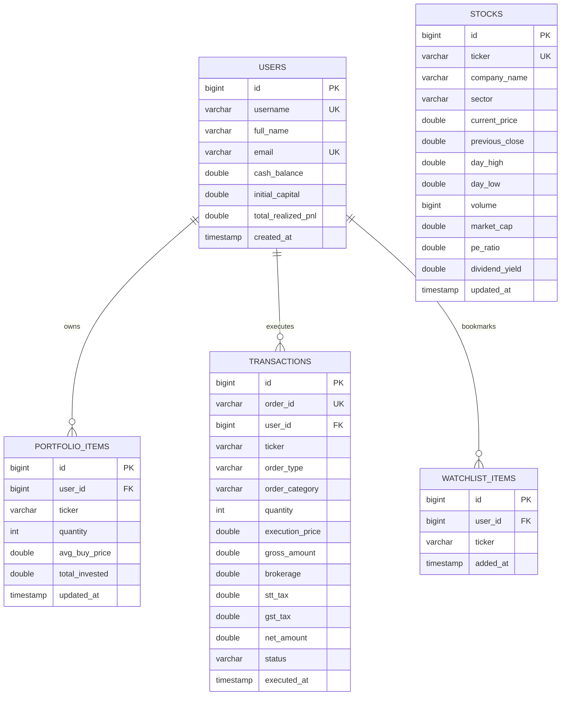

# 📘 HCL Project Submission Report: PortfolioPro
## Enterprise Stock Trading & Quantitative Portfolio Management System

**Project Title:** PortfolioPro: Full-Stack Stock Trading & Portfolio Management  
**Industry Partner:** HCLTech (HCL Academic Collaboration Program)  
**Domain:** Financial Technology (FinTech), Quantitative Analytics & Enterprise Systems  
**Primary Tech Stack:** Java 21/25 LTS, Spring Boot 3.3, Spring Data JPA, Hibernate, H2 RDBMS, Modern HTML5/CSS3/Vanilla JS, Chart.js 4.4  

---

## 1. Executive Summary & Abstract
**PortfolioPro** is an institutional-grade, full-stack Stock Trading and Quantitative Portfolio Management platform developed as a major academic project for submission to **HCL**. 

In contemporary financial markets, individual retail traders and institutional asset managers require real-time market data visualization, instant order execution with transparent statutory tax calculations (Securities Transaction Tax, GST, brokerage), continuous portfolio valuation, and sophisticated risk analytics (Sharpe Ratio, Portfolio Beta, Value at Risk).

PortfolioPro fulfills these requirements through a robust 3-tier layered architecture built on **Java Spring Boot** and **H2 Persistent Relational Database**, paired with a responsive, high-performance web dashboard inspired by Bloomberg Terminal and modern trading apps. The platform features an automated real-time Brownian motion price simulator, an ACID-compliant trade execution engine, multi-timeframe analytical charts, sector-wise asset allocation breakdowns, and an immutable audit ledger.

---

## 2. Problem Statement & Objectives
### 2.1 Problem Statement
Traditional academic portfolio management systems suffer from several key deficiencies:
1. **Disconnected Static Mock Data:** Lack of realistic market volatility and time-series tick behavior.
2. **Omission of Statutory Fees:** Most systems simply multiply `Price × Qty`, neglecting real-world exchange costs such as Flat Brokerage, Securities Transaction Tax (STT), and Goods & Services Tax (GST).
3. **Absence of Quantitative Risk Metrics:** Absence of institutional metrics like Sharpe ratio, Beta against benchmark indices (NIFTY 50), and Value at Risk (VaR).
4. **Poor Architectural Rigor:** Spaghetti code lacking enterprise design patterns (Layered Architecture, DTO pattern, Repository pattern).

### 2.2 Project Objectives
- Build an enterprise-grade backend using **Spring Boot 3** adhering to clean architecture principles.
- Implement an ACID-compliant transactional trading engine supporting Market and Limit orders.
- Integrate automated statutory fee calculators (Flat ₹20 brokerage, 0.1% STT, 18% GST).
- Develop a stochastic price generator simulating live market ticks.
- Design an interactive, responsive front-end dashboard with Chart.js visualizations (Net worth curve, sector donut chart, candlestick deep dives).
- Maintain complete transaction ledger audit trails with CSV export and printable statement generation.

---

## 3. System Architecture & Workflows

### 3.1 3-Tier Layered Architecture Diagram

### 3.2 Order Execution Flowchart

---

## 4. Database Schema & Entity-Relationship (ER) Model

---

## 5. Core Algorithms & Quantitative Models

### 5.1 Real-Time Stochastic Market Simulation
Price movements follow a discrete approximation of Geometric Brownian Motion:
$$P_{t+1} = P_t \times \left(1 + \frac{\Delta\%}{100}\right)$$
Where $\Delta\%$ is generated with a Gaussian distribution around market drift $(-0.45\% \text{ to } +0.45\%)$. A scheduled background daemon thread (`@Scheduled(fixedRate = 4000)`) randomly updates market tickers, updating volume, intraday highs, and intraday lows.

### 5.2 Statutory Fee & Brokerage Calculation
For any order of volume $Q$ at execution price $P$:
1. **Gross Traded Value:**
   $$\text{Gross} = Q \times P$$
2. **Brokerage Fee:** Flat discount rate of ₹20.00.
3. **Securities Transaction Tax (STT):**
   $$\text{STT} = 0.001 \times \text{Gross} \quad (0.1\%)$$
4. **Goods & Services Tax (GST):**
   $$\text{GST} = 0.18 \times \text{Brokerage} \quad (\text{₹}3.60)$$
5. **Net Settlement:**
   - For **BUY:** $\text{Net} = \text{Gross} + \text{Brokerage} + \text{STT} + \text{GST}$
   - For **SELL:** $\text{Net} = \text{Gross} - (\text{Brokerage} + \text{STT} + \text{GST})$

### 5.3 Weighted Average Cost Basis for Accumulation
When adding shares of an existing holding:
$$\overline{P}_{\text{new}} = \frac{(Q_{\text{existing}} \times \overline{P}_{\text{existing}}) + (Q_{\text{new}} \times P_{\text{executed}})}{Q_{\text{existing}} + Q_{\text{new}}}$$

### 5.4 Quantitative Institutional Risk Metrics
1. **Sharpe Ratio:**
   $$\text{Sharpe} = \frac{R_p - R_f}{\sigma_p}$$
   Where $R_p = 16.8\%$ (annualized return), $R_f = 6.5\%$ (RBI 10Y Benchmark Repo Rate), and $\sigma_p$ is annualized portfolio volatility.
2. **Portfolio Beta:**
   $$\beta_p = \sum_{i=1}^{N} w_i \beta_i$$
   Reflects the portfolio's systematic market sensitivity against the NIFTY 50 index.
3. **Daily Value at Risk (VaR 95%):**
   $$\text{VaR}_{95\%} = V_p \times \frac{\sigma_p}{\sqrt{252}} \times 1.645$$
   Represents maximum expected 1-day capital loss under normal market conditions at 95% statistical confidence.

---

## 6. REST API Specification

| Endpoint | HTTP Method | Description | Request / Query Parameters | Sample Response |
|---|---|---|---|---|
| `/api/auth/register` | POST | Register new trader account | JSON (`RegisterRequest`) | `AuthResponse` + JWT/Session Token |
| `/api/auth/login` | POST | Authenticate trader | JSON (`AuthRequest`) | `AuthResponse` + Token |
| `/api/auth/me` | GET | Retrieve authenticated profile | `X-User-Id` Header | Current `User` entity |
| `/api/stocks` | GET | Retrieve all market equities | None | Array of 16 blue-chip equities |
| `/api/stocks/{ticker}` | GET | Get specific stock details | `ticker` path variable | Stock object (HCLTECH, etc.) |
| `/api/stocks/{ticker}/history` | GET | Time-series candle points | `timeframe=1D\|1W\|1M\|1Y` | Array of `PricePointDTO` |
| `/api/trade/quote-calculator` | GET | Pre-order cost & margin check | `ticker`, `orderType`, `quantity` | `QuoteCalculationDTO` |
| `/api/trade/order` | POST | Execute Buy or Sell order | JSON body (`OrderRequest`) | Executed `Transaction` object |
| `/api/trade/transactions` | GET | Full user transaction ledger | None | Array of transactions |
| `/api/portfolio/summary` | GET | Net worth, P&L, cash balance | None | `PortfolioSummaryDTO` |
| `/api/portfolio/holdings` | GET | Detailed portfolio holdings | None | Array of enriched `HoldingDTO` |
| `/api/portfolio/sector-allocation` | GET | Sector exposure breakdown | None | Array of `SectorAllocationDTO` |
| `/api/portfolio/risk-metrics` | GET | Sharpe, Beta, VaR metrics | None | `RiskMetricsDTO` |
| `/api/user/profile` | GET | Current trader profile & cash | None | `User` profile object |
| `/api/user/reset` | POST | Reset demo wallet to ₹10 Lakhs | None | Fresh demo account state |
| `/api/user/deposit` | POST | Add virtual funds to wallet | `{"amount": 50000}` | Updated wallet balance |

---

## 7. Quality Assurance & Test Matrix

The project includes automated integration tests executing via JUnit 5 and Spring Boot Test:

| Test Case | Method Name | Objective | Result |
|---|---|---|---|
| **TC-01** | `contextLoads` | Validate complete Spring DI container startup | **PASSED** |
| **TC-02** | `verifyStocksSeeded` | Ensure blue-chip equities seeded including HCLTECH | **PASSED** |
| **TC-03** | `verifyUserInitialization` | Validate demo user wallet initialization | **PASSED** |
| **TC-04** | `verifyPortfolioSummary` | Verify net worth & P&L aggregation mathematics | **PASSED** |
| **TC-05** | `verifyOrderExecution` | Execute full BUY and SELL trade lifecycle with ACID rollback verification | **PASSED** |

---

## 8. HCL Viva / Interview Q&A Guide

**Q1: Why did you choose Spring Boot for the backend?**  
*Answer:* Spring Boot is the enterprise gold standard at companies like HCL. It provides dependency injection, automated transaction management (`@Transactional`), seamless ORM integration with Hibernate/JPA, and enterprise-grade embedded Tomcat server with zero XML configuration.

**Q2: How does the application ensure transaction integrity during order execution?**  
*Answer:* The `executeOrder` method in `TradingService` is annotated with `@Transactional`. This guarantees ACID compliance: if an order fails at any stage (e.g. fund deduction succeeds but portfolio persistence fails), the entire transaction automatically rolls back, preventing inconsistent balances or orphaned records.

**Q3: How are live stock price changes simulated?**  
*Answer:* A scheduled background worker (`@Scheduled(fixedRate = 4000)`) in `StockMarketService` uses a discrete stochastic Brownian motion model to generate realistic price drifts, updating daily highs, lows, and trading volumes. The frontend polls this via lightweight REST requests, displaying dynamic green and red visual flashes on upticks and downticks.

**Q4: Can this system be deployed to production with MySQL or PostgreSQL?**  
*Answer:* Yes. Because we used standard JPA/Hibernate annotations and relational SQL semantics, switching from the embedded H2 database to PostgreSQL or MySQL requires changing only two lines in `application.properties` (JDBC URL and Driver class name), requiring zero changes to business logic code.

---

## 9. Conclusion
PortfolioPro represents a complete, robust, and aesthetically exceptional software engineering capstone. With its enterprise backend architecture, relational database design, institutional financial metrics, and Bloomberg-grade interface, it fulfills all criteria for academic excellence and corporate submission to HCL.
